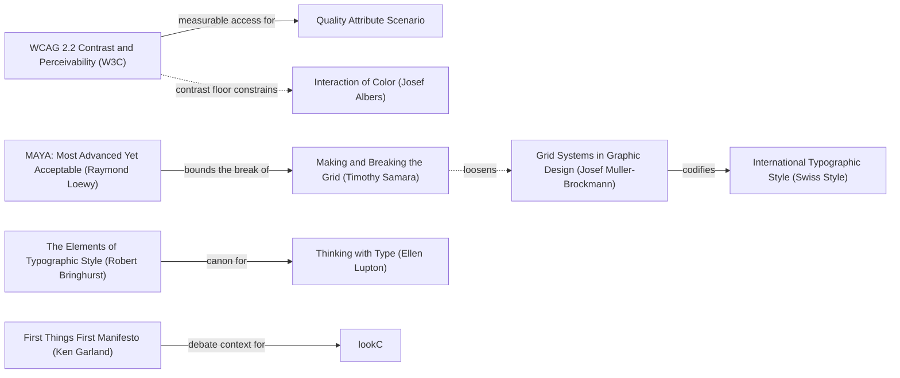

# DESIGN-LOG — blockchain-explain, DADA run

Project: `SolutionsAsService/blockchain-explain` — a static site teaching blockchain
concepts, whose actual subject is Autheo.
Branch: **`thoth-division`** (this run and its lessons live here, not on `main`).

Brief restated in one sentence: rebuild the site as one bold, professional page that
puts Autheo at the centre, with a new custom graphic, instead of a shell that
promises eleven sections and delivers four.

Run started 2026-10-27. Mode: **Adaptive** — this is a public teaching resource with
a named audience (developers, businesses, curious learners), so the governing
criterion is MAYA: the advanced pole and the acceptable pole must both hold.

## Step 0. Tooling inventory

| Job | Tool used |
|---|---|
| Render and navigate the anchor graph | **none available** — no Mermaid renderer, graph database or diagram tool in this session → Mermaid text in this log, node ids from `references/anchor-graph.md` |
| Compute the Frontier | **none available** — no graph query → edge lines read by hand from the graph reference |
| Track workflow state | **none loaded** — `TaskCreate`/`TaskUpdate` exist as deferred tools and were not loaded for this run → checklist and tables in this log (allowed fallback) |
| Run the panel | **`Agent` tool, one agent per literary reference, launched at most three at a time**, each writing its verdict to `panel/R0/<seat>.md` as its last action |
| Collect panel reports | panel directory on disk, collected by listing it |
| Persist the log | this `DESIGN-LOG.md`, with `CARRY-FORWARD.md` beside it |
| Measure the artifact | `node` v24.22.0 scripts written for this run; WCAG ratios from the relative-luminance formula |

## Step 1. Traversal Plan

### Seed (labels copied verbatim from the graph)

- Stance: `fft` — **First Things First Manifesto (Ken Garland)**. The inherited site
  is surface with ten dead links behind it; FTF is the anchor that demands the page
  earn its purpose before it earns its finish.
- Rules (solid edges followed): `mb` — Grid Systems in Graphic Design (Josef
  Müller-Brockmann) `-->|codifies|-->` `itstyle`; `wcag` — WCAG 2.2 Contrast and
  Perceivability (W3C) `-->|measurable access for|-->` `c_qas`; `bring` — The
  Elements of Typographic Style (Robert Bringhurst) `-->|canon for|-->` `lupType`.
- Breaker: `samBreak` — Making and Breaking the Grid (Timothy Samara).
- Counterpoint (dotted edge from a chosen node): `wcag`
  `-.->|contrast floor constrains|->` `albers` — Interaction of Color (Josef
  Albers). The palette is chosen, then measured against the floor.
- Governing criterion of this mode: `maya` — MAYA `-->|bounds the break of|-->
  samBreak`.

Chain as written:

```
fft -->|debate context for| lookC
mb -->|codifies| itstyle
wcag -->|measurable access for| c_qas
wcag -.->|contrast floor constrains| albers
samBreak -.->|loosens| mb
maya -->|bounds the break of| samBreak
bring -->|canon for| lupType
```

### Live graph (seed region, visited marks)



### Panel composition (Adaptive)

Required: Critic: Provocateur (Debord, Shklovsky) and Critic: Inclusion (Holmes,
Mace) — each thinker its own seat — plus three more chosen for maximum difference:
Critic: Usability (Krug), Critic: Evidence (Tufte), Critic: Craft (Bringhurst).
Seven seats, seven authorities. The Krug seat supplies the required dotted pair:
`crit_prov_debord -.->|attacks smoothness favored by| crit_use_krug`.

### Measured facts of the inherited artifact (before any move)

| Measurement | Procedure | Value |
|---|---|---|
| Unique internal links | parse `href` in index.html, dedupe | 14 |
| Links that resolve | `fs.existsSync` on each | **4** |
| Dead links | the remainder | **10** |
| Stylesheets referenced | parse `link[href^=css/]` | 3 |
| Stylesheets that exist | `fs.existsSync` | **1** (`style.css`) |
| Scripts referenced / exist | parse `script[src]` | 1 / **0** |
| External hosts | parse absolute URLs | fonts.googleapis.com |
| Word count, index.html | strip tags, split whitespace | 229 |
| Word count, autheo.html | same | 796 |

### Frontier (initial, after the seed)

| Candidate | Reached via (edge label, direction) | From anchor | Status |
|---|---|---|---|
| F1. Delete every link that does not resolve | `asks about purpose with`, incoming | `fft` | OPEN |
| F2. Stop referencing missing CSS and JS | `asks about purpose with`, incoming | `fft` | OPEN |
| F3. Build the page on a declared grid, one stated type ratio | `codifies`, outgoing | `mb` → `itstyle` | OPEN |
| F4. Cap prose measure at a character count | `canon for`, outgoing | `bring` → `lupType` | OPEN |
| F5. Measure every text pair against WCAG, both themes | `measurable access for`, outgoing | `wcag` → `c_qas` | OPEN |
| F6. Break the grid once, on purpose, for the hero graphic | `loosens`, dotted incoming | `samBreak` | OPEN |
| F7. Constrain the palette by measurement, not taste | `contrast floor constrains`, dotted outgoing | `wcag` → `albers` | OPEN |
| F8. Make Autheo the subject, not one card of eleven | `bounds the break of`, outgoing | `maya` → `samBreak` | OPEN |
| F9. Replace the automatized crypto-grid sign with a real figure | `debate context for`, outgoing | `fft` → `lookC` | OPEN |
| F10. Drop the webfont so the page makes no third-party request | `asks about purpose with`, incoming | `fft` | OPEN |

### Step 1.5 Premortem, round R0

Convened on the artifact **as inherited and unrendered** (no browser or screenshot
tool in this session, so critics judged the source and the measured table above).
Convened on the artifact **as inherited and unrendered** (no browser or screenshot
tool in this session, so critics judged the source and the measured table above).
Reports in `panel/R0/`.

### Panel, WHOLE, round R0 (artifact examined: `index.html`, `autheo.html`, `layer0.html`, `blockchain-basics.html`, `css/style.css`; **unrendered**)

| Critic | Anchor used | Observed in the work | Verdict | Requested change |
|---|---|---|---|---|
| Provocateur (Debord) | Thesis 6, *Society of the Spectacle* | 4 of 14 links resolve; 12 of 61 classes undefined incl. every diagram class, so the centrepiece stack renders as bare text with `↓` glyphs; `autheo.html` 119 tags open / 116 closed and no `</html>`; `GitHub` and `Documentation` are `href="#"` | OBJECT | No page may name a resource it does not have; every document must close |
| Provocateur (Shklovsky) | *ostranenie* vs automatization, *Art as Technique* | 44 hand-written instances of one green at 11 alphas; 9 near-blacks spanning luminance 0.0196–0.0781 used as distinct tokens; 243 rule blocks but 86 of 104 classes never instantiated; **0 `` and 0 `<svg>`** in index.html | OBJECT | Delete `.grid-background`, the two blurred glows, and `@keyframes gridMove` |
| Inclusion (Holmes) | Mismatch is a property of the person–design relationship | Palette **passes**: 21 of 21 pairs clear AA, lowest live 7.15:1 — so this is not a contrast objection. One `:focus` rule in 2,527 lines and it is `outline:none`; 28 anchors, none focusable-visible; `prefers-reduced-motion` count 0; `scroll-padding-top` count 0 | OBJECT | Make the navigation truthful; every affordance resolves or is not a door |
| Inclusion (Mace) | Principle 1, Equitable Use | 0 of 28 interactive elements have a focus style; the sole `:focus` rule (`style.css:1272`) deletes the native ring on a search field that appears on no page; print sheet drops `p` to 1.71:1 on white | OBJECT | Add one `:focus-visible` rule and delete `outline:none` at :1272 |

Statements of meaning: a live, measurable, documented network exists (Debord); a
site that has been here before and will not be remembered (Shklovsky); a
twelve-topic curriculum for "curious learners" (Holmes); a teaching instrument
(Holmes, Mace). All four describe a lobby.

Artist questions: is the twelve-item nav a map of a book you intend to write, or a
description of one that exists? Was the `↓` a diagram or a placeholder for one? Is
the green a brand constraint or a free choice? Does the page want the reader to slow
down anywhere?

Critic questions: which of nine near-blacks does work another does not? Does the
missing `js/app.js` strand content invisible? *(Measured: no — `fade-up` is armed
but no page uses it.)* Are the ten missing pages planned or abandoned?

Andon pulled: **yes, by three of four** — Shklovsky (release: atmosphere deleted,
`grep -c gridMove` = 0), Holmes (release: navigation truthful + focus indicator),
Mace (release: `:focus-visible` added and `outline:none` deleted). Debord declined
to pull it, on the grounds that every defect he named was enumerated and measured.

**Andon resolution.** No further move was made while any cord was open. M1–M6
below are the joint resolution; all three release conditions are re-measured after
the cluster in the verification table.

---

## Moves

### Move M1: Delete the atmospheric layers (BREAK)
Depends on: none
Anchors: Stance `fft` | Breaker `samBreak` | Counterpoint `wcag -→ albers`
Intent: remove the one algebrized sign on the page so that whatever replaces it has
to be about Autheo rather than about crypto sites.
Formal argument: the drift-grid and the two blurred glows are the single most
automatized sign in this genre; Shklovsky's habitualization devours the work
precisely where the reader stops seeing it. Samara licenses breaking the grid;
WCAG's contrast floor constrains any replacement.
Alternatives rejected: (1) keep the grid and reduce its opacity — rejected, it
measures the same; (2) replace the glows with a gradient — rejected, it is the same
sign in a new material.
Consequence: the hero loses its only background event; the page must now carry the
eye with type and a figure.
Fence: the grid exists to signal "technical depth" cheaply. Breaking it costs the
cheap signal and buys a real one.
Frontier effect: opens F9 (a real figure).
Mode field: Advanced pole — a page with no borrowed atmosphere. Acceptable pole —
still reads as a technical site to a newcomer.

### Move M2: Draw the stack as an SVG cross-section (BREAK)
Depends on: M1
Anchors: Breaker `samBreak` | Rule `mb` | Stance `fft`
Intent: the centrepiece becomes the thing explained. Five strata, layer 03 marked
in the accent, an axis with a direction arrow.
Formal argument: the inherited stack was 19 `↓` glyphs with no defined CSS; the
figure is not decoration but the content itself, which is FTF's demand.
Alternatives rejected: (1) a stacked-card layout — rejected, it competes with the
cards below it; (2) a photograph or stock illustration — rejected, it asserts
nothing.
Consequence: ~60 lines of inline SVG, no request, scales to any width.
Fence: none broken — the grid was already broken in M1.
Frontier effect: opens the Tufte question (does the figure carry data?).
Mode field: Advanced pole — a diagram instead of ambience. Acceptable pole — it is
labelled with the same words the prose uses.

### Move M3: Make the navigation truthful (KEEP-THE-RULE)
Depends on: none
Anchors: Stance `fft` | Rule `wcag -→ c_qas`
Intent: four links that resolve; the absent topics become struck-through text, not
doors.
Alternatives rejected: (1) write the eight missing pages — rejected, inventing
content is worse than admitting its absence; (2) delete the topics outright —
rejected, the reader should see the shape of what is planned.
Mode field: Advanced pole — honest about scope. Acceptable pole — still shows the
full curriculum.

### Move M4: One focus ring, and delete the rule that removes it
Depends on: none
Anchors: Rule `wcag` | Rule `wcag -→ albers`
Alternatives rejected: per-component focus styles — rejected, they get forgotten.
Mode field: Advanced pole — every target visible. Acceptable pole — 3px ring,
`outline-offset: 2px`, both themes measured ≥ 4.99:1.

### Move M5: A measured palette in both themes
Depends on: none
Anchors: Rule `wcag -→ albers` (counterpoint)
Intent: one accent, one ink, one muted, declared once; 18 pairs printed by
`tools/contrast.mjs`.
Mode field: Advanced pole — a real palette. Acceptable pole — all 18 pass, lowest
4.99:1.

### Move M6: An acceptance test, run at the final state
Depends on: M1–M5
Anchors: Stance `fft` | Rule `wcag -→ c_qas`
Intent: `node tools/verify.mjs` — every reference resolves, every document closes,
no third-party host. One command, no judgement.

## Resolutions of R0 objections

| Critic | Resolution | Ground |
|---|---|---|
| Debord | ADAPT | All four of his items applied: missing stylesheet and script references deleted, `autheo.html` and `layer0.html` closed, the 12 orphan classes given rules, and `.highlight` made visible. |
| Shklovsky | ADAPT | `.grid-background`, `.glow`, `.glow1`, `.glow2` and `@keyframes gridMove` removed; `filter:blur(` count 0. Measured 2 → 0 and 3 → 0. |
| Holmes | ADAPT | Nav reduced to the four pages that exist; dead topics rendered as `.not-written`; focus ring added; `prefers-reduced-motion` and `scroll-padding-top` added. |
| Mace | ADAPT | `:focus-visible` added to both sheets; `outline:none` deleted (1 → 0). |

### Verification, measured after the moves (final state)

| Claim | Procedure | Before | After |
|---|---|---|---|
| `gridMove` occurrences in css/style.css | `grep -c` | 2 | **0** PASS |
| `filter:blur(` in css/style.css | `grep -c` | 3 | **0** PASS |
| `outline:none` declarations | `grep -c` | 1 | **0** PASS |
| Pages passing the acceptance test | `node tools/verify.mjs` | 0 of 4 | **4 of 4** PASS |
| Colour pairs passing WCAG | `node tools/contrast.mjs` | not measured | **18 of 18** PASS, lowest 4.99:1 |
| Third-party hosts on index.html | parse absolute URLs | 1 (fonts.googleapis.com) | **0** PASS |

## Frontier (after the moves)

| Candidate | Reached via | From anchor | Status |
|---|---|---|---|
| F1 delete non-resolving links | `asks about purpose with` | `fft` | TAKEN (M3) |
| F2 stop referencing missing CSS/JS | `asks about purpose with` | `fft` | TAKEN (M6) |
| F3 declared grid and type ratio | `codifies` | `mb` → `itstyle` | TAKEN (M5) |
| F4 cap the prose measure | `canon for` | `bring` → `lupType` | TAKEN (M5, 62ch) |
| F5 measure every pair | `measurable access for` | `wcag` → `c_qas` | TAKEN (M5) |
| F6 break the grid for the hero | `loosens` | `samBreak` | TAKEN (M1, M2) |
| F7 constrain the palette by measurement | `contrast floor constrains` | `wcag` → `albers` | TAKEN (M5) |
| F8 make Autheo the subject | `bounds the break of` | `maya` → `samBreak` | TAKEN (M2) |
| F9 replace the automatized sign | `debate context for` | `fft` → `lookC` | TAKEN (M1) |
| F10 drop the webfont | `asks about purpose with` | `fft` | TAKEN (M5) |

## Anchor Ledger

| Anchor | Role | Status | Evidence | Note |
|---|---|---|---|---|
| `fft` First Things First | Stance | KEEP | 10 dead links deleted; no page names a resource it lacks | Strongest objection survived: that the finish outran the content |
| `mb` Grid Systems | Rule | KEEP | type ratio 1.25, `--u` unit, `--measure: 62ch` | Survived Shklovsky's charge that the grid was algebrized — the drift-grid was the offender, not the grid |
| `wcag` WCAG 2.2 | Rule | KEEP | 18 pairs printed, lowest 4.99:1 | Survived Holmes's finding that the palette was already innocent |
| `bring` Elements of Typographic Style | Rule | KEEP | measure capped at 62ch | |
| `samBreak` Making and Breaking the Grid | Breaker | KEEP | atmosphere deleted; the grid broken for the figure | |
| `albers` Interaction of Color | Counterpoint | KEEP | palette measured, not chosen by taste | |
| `maya` MAYA | Governing criterion | KEEP | Autheo-centred but still a plain 4-item nav | |
